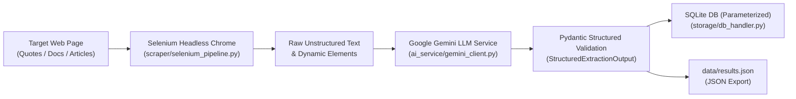

# AI-Powered Assistant & Automation Pipeline

A production-ready, modular automation pipeline built in Python that pairs **Selenium headless web scraping** with **Google Gemini Structured Outputs (Pydantic)** and **secure parameterized SQLite persistence**, complete with automatic JSON dataset exports and exponential backoff retry handling.

---

## Architecture Overview



### Key Modules:
- **`app.py`**: Full-featured Flask web backend providing RESTful endpoints, live status metrics, database queries, and serving the interactive dashboard.
- **`templates/index.html`** & **`static/`**: High-performance cyber-glassmorphic frontend with dark mode, live stepper progress bar, KPI analytics ribbon, database search/filter explorer, and modal inspector.
- **`config.py`**: Centralized configuration management using `python-dotenv`. Manages model parameters, browser switches, paths, and timeouts.
- **`scraper/selenium_pipeline.py`**: Enterprise-grade Selenium WebDriver manager with headless mode, anti-bot user-agent headers, explicit `WebDriverWait` conditions, and safe context manager teardown.
- **`ai_service/gemini_client.py`**: Enforces Gemini Structured Outputs using Pydantic schemas. Features exponential backoff retry algorithms for HTTP 429 (rate limits) and transient outages, with dual-SDK support (`google-genai` and `google-generativeai`).
- **`storage/db_handler.py`**: Secure SQLite storage using strictly parameterized queries (`?`) to guarantee zero SQL injection risks, coupled with automated JSON dataset exports.
- **`pipeline.py`**: The CLI orchestration engine executing Scrape &rarr; Extract &rarr; Persist &rarr; Export.
- **`tests/test_pipeline.py`**: Comprehensive unit and integration test suite using `pytest`.

---

## Structured Output Schema (Pydantic)

The pipeline enforces structured data extraction conforming to this contract:

```python
class SentimentSecurityAnalysis(BaseModel):
    sentiment: Literal["Positive", "Neutral", "Negative", "Mixed"]
    sentiment_score: float  # Range: -1.0 to 1.0
    security_implications: str
    risk_level: Literal["Low", "Medium", "High", "Critical"]

class StructuredExtractionOutput(BaseModel):
    title: str
    summary: str
    categorized_topics: List[str]
    key_takeaways: List[str]
    analysis: SentimentSecurityAnalysis
    confidence_score: float
```

---

## Quickstart & Setup Guide

### 1. Prerequisites
- **Python**: 3.10+ (tested on Python 3.13)
- **Google Chrome**: Installed on the host machine
- **Google Gemini API Key**: Obtain a key from [Google AI Studio](https://aistudio.google.com/app/apikey)

### 2. Environment Setup

Clone or navigate to the project directory:
```powershell
cd C:\Users\manuj\.gemini\antigravity-ide\scratch\ai_automation_pipeline
```

Create a virtual environment and activate it:
```powershell
python -m venv .venv
.\.venv\Scripts\Activate.ps1
```

Install the required dependencies:
```powershell
pip install -r requirements.txt
```

### 3. Configure Environment Variables

Copy the template `.env.example` into `.env`:
```powershell
Copy-Item .env.example .env
```

Open `.env` and set your Gemini API key:
```ini
GEMINI_API_KEY=AIzaSy...your_actual_key_here
GEMINI_MODEL=gemini-2.5-flash
DEFAULT_TARGET_URL=https://quotes.toscrape.com/
HEADLESS_BROWSER=True
```

*(Note: If no API key is configured or you pass `--dry-run`, the pipeline will automatically utilize simulated validated structured extraction, allowing you to test the scraper, database, and export components immediately without API consumption!)*

---

## Execution Guide

### 1. Launch Interactive Web Dashboard (Recommended)
```powershell
.\.venv\Scripts\python app.py
```
Open **[http://127.0.0.1:8000](http://127.0.0.1:8000)** in your browser to access the complete interactive interface.

### 2. Standard CLI Run (Default Target Scrape + Extraction)
```powershell
.\.venv\Scripts\python pipeline.py
```

### 2. Scrape a Custom Target URL
```powershell
.\.venv\Scripts\python pipeline.py --url "https://quotes.toscrape.com/tag/humor/"
```

### 3. Dry-Run / Test Mode (No Gemini Credits Used)
```powershell
.\.venv\Scripts\python pipeline.py --dry-run
```

### 4. Non-Headless Mode (Show Browser Window)
```powershell
.\.venv\Scripts\python pipeline.py --no-headless
```

### 5. Inspect Stored SQLite Database Records
```powershell
.\.venv\Scripts\python pipeline.py --list
```

### 6. Custom Export Path
```powershell
.\.venv\Scripts\python pipeline.py --export-json "data/custom_output.json"
```

---

## Running the Automated Test Suite

Run all unit, integration, and mock tests with `pytest`:
```powershell
.\.venv\Scripts\pytest -v tests/
```

Test coverage includes:
1. `test_config_defaults`: Config parsing and API key validation.
2. `test_pydantic_schema_validation`: Strict Pydantic type checks, score bounds, and JSON serialization.
3. `test_gemini_response_sanitizer`: Stripping markdown code blocks from model responses.
4. `test_gemini_simulated_output`: Conformance of fallback simulated data.
5. `test_database_parameterized_insertion_and_retrieval`: SQL injection prevention, WAL mode, and JSON arrays.
6. `test_full_pipeline_mock_orchestration`: Complete end-to-end orchestration with mock browser teardown.

---

## Security & Reliability Design Patterns

| Feature | Implementation Details |
| :--- | :--- |
| **SQL Injection Prevention** | All SQL commands use parameterized placeholders (`?`). String formatting/f-strings are strictly prohibited. |
| **Exponential Backoff** | Handles HTTP 429 (`ResourceExhausted`) and transient network faults using `delay = base * (2 ^ attempt) + jitter`. |
| **WebDriver Lifecycle** | Clean teardown enforced using Python Context Managers (`with SeleniumPipelineScraper() as scraper:`) inside `finally` blocks. |
| **Type Integrity** | Pydantic v2 `BaseModel` guarantees that data stored in SQLite and exported to JSON strictly matches the schema. |
| **Dual-SDK Support** | Seamlessly works with either the modern `google-genai` SDK or `google-generativeai`. |

---

## Troubleshooting Guide

- **`SessionNotCreatedException` / Chrome Version Mismatch**:
  `webdriver-manager` automatically manages driver binaries. Ensure Chrome is up to date in `Help -> About Google Chrome`.
- **`ResourceExhausted (429)`**:
  The client automatically backs off and retries. You can increase `MAX_API_RETRIES` or `INITIAL_BACKOFF_SECONDS` in `.env`.
- **Blocked by Cloudflare/Anti-Scraping**:
  `SeleniumPipelineScraper` injects realistic desktop user-agents and disables `enable-automation` switches. For complex bot-detection, non-headless mode (`--no-headless`) can be enabled.
